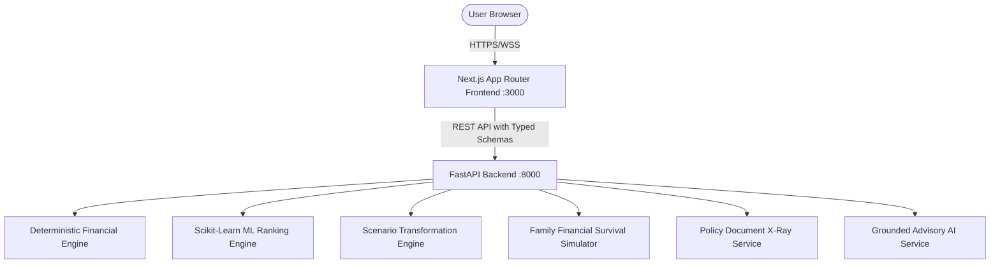

# LifeSure AI Architecture & Technical Specification

## 1. System Overview
LifeSure AI is an intelligent financial protection platform designed for India, delivering deterministic insurance needs assessment, explainable machine learning product recommendations, dynamic financial scenario analysis, and policy intelligence.

## 2. Core Architectural Principles
1. **Separation of Concerns:** 
   - Generative AI **never** computes financial sums, gap amounts, or policy pricing.
   - Deterministic Python financial engine computes all present values, gap calculations, and scenario projections.
   - The ML model operates strictly on candidate product scoring and ranking after hard-rule eligibility filtering.
2. **Defensive API Design:**
   - Strict Pydantic v2 schemas for all inputs and outputs.
   - CORS, HSTS, security headers, request limits, rate limiting.
   - Zero hardcoded production secrets.
3. **Accessibility & Design:**
   - WCAG 2.2 AA compliant typography, focus states, high contrast ratios.
   - Brand tokens: Deep Navy (`#0B1F4D`), Electric Blue (`#2672FF`), Ice Blue (`#E6F0FF`), Slate surfaces.
   - Tabular numerals for all Indian Rupee (`₹`) figures in Crores (`Cr`) and Lakhs (`L`).
