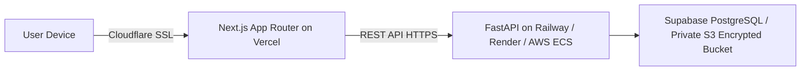

# LifeSure AI - Deployment Guide

## 1. System Architecture Deployment



## 2. Environment Variables

### Frontend (`frontend/.env.local`):
```env
NEXT_PUBLIC_API_URL=http://127.0.0.1:8000/api/v1
```

### Backend (`backend/.env`):
```env
SECRET_KEY=replace_with_strong_hex_in_production
ACCESS_TOKEN_EXPIRE_MINUTES=1440
GEMINI_API_KEY=your_gemini_api_key_here
```

## 3. Local Development Startup

### 1. Start Python FastAPI Backend:
```bash
source .venv/bin/activate
PYTHONPATH=backend uvicorn app.main:app --host 127.0.0.1 --port 8000 --reload
```
API Docs available at: `http://127.0.0.1:8000/docs`

### 2. Start Next.js Frontend:
```bash
cd frontend
npm run dev
```
Web App accessible at: `http://127.0.0.1:3000`

### 3. Run Automated Test Suites:
```bash
# Python Backend Pytest Suite (Unit + Integration)
PYTHONPATH=backend .venv/bin/pytest backend/tests/ -v

# Frontend TypeScript & Turbopack Production Compilation
cd frontend && npm run build
```
